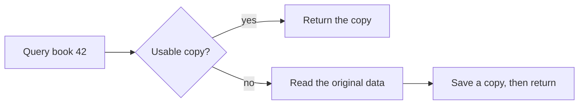

# Teacher Diagram Rendering

Standard technical diagrams use **Pele 1.9.0**, pinned in this skill's package and lockfile.
Node.js 20 or newer is required when generating figures. Reading the delivered course
requires neither Node.js nor network access.

## Separate meaning, view and rendering

Use the statechart approach: first describe the relevant states, events, conditions and
relationships; then project them into the learner's words; finally render the chosen view.
Pele calculates node geometry, text layout and edge routes. Do not maintain a second set
of handwritten SVG coordinates for the same standard diagram.

- Give nodes stable semantic identifiers, separate from their display labels. Keep lesson
  steps, focus paths, source locations and frame explanations attached to those identifiers.
- Name states as the learner understands them. Label transitions with the triggering event
  and relevant guard. Code identifiers can appear in the source mapping without taking
  over the entire diagram's vocabulary.
- Use flat states for a small lifecycle, parent states for nested phases, and parallel
  regions only when their simultaneous combinations and conditions are justified.
  Do not imply an execution order from visual position alone.
- Preserve initial states, terminal states, recovery conditions and important failure
  paths when simplifying. Merging states must not hide different failure causes or
  introduce a transition the source does not allow.
- Derive the focused diagram and the current-frame explanation from the same view data.
  A stepper must explain its current observation before revealing the final result.

The renderer parses the diagram and computes its layout; it does not verify the behavior
of the taught system.
Keep teaching assumptions, source-backed explanations and genuinely checked model results
distinct. TLA+/TLC is an optional way to help the learner explore the subject's behavior,
even when formal verification is not the lesson's main topic. Read
[Model-driven Learning](model-driven-learning.md) when using it. Do not install it or
claim its guarantees merely to draw a state diagram.

## Generate a real figure

Install the author's dependency once with the bundled lockfile:

```sh
npm ci --ignore-scripts --prefix <skill-dir>
```

Write a Mermaid file with meaningful accessibility text and stable node IDs:



Use the lecture's chosen language for actual labels, cues and explanations. Generate
wide and narrow views from the same semantic source:

```sh
node <skill-dir>/scripts/render-diagram.mjs figure.mmd --out figure-wide.svg --width 740 --id-prefix lesson-cache-wide
node <skill-dir>/scripts/render-diagram.mjs figure.mmd --out figure-narrow.svg --width 320 --id-prefix lesson-cache-narrow
```

For a repeated authoring build, import the small generator directly:

```js
import { renderTeacherDiagram } from '<skill-dir>/scripts/render-diagram.mjs';
const svg = renderTeacherDiagram(mermaidSource, {
  width: 320,
  idPrefix: 'lesson-cache-narrow',
});
```

Each mounted instance, variant and reading/comparison clone needs its own `idPrefix`.
Semantic node `data-id` values remain the same within their own SVG. Scope DOM lookups
under the current SVG rather than querying the document for a shared node ID.

The generator applies Teacher's theme and disables diagram links and images. Keep course
navigation/source actions in the reader's own mapping and controls. Errors are reported
before an existing output file is overwritten; correct the source rather than inventing
a successful-looking fallback.
The default paper colors come from [reader-themes.json](../assets/reader-themes.json);
embedded figures inherit the active reader palette through `--reader-*` CSS variables.
Controlled teaching playback is owned by the reader, as described in
[Reader Theme and Teaching Motion](reader-theme-and-motion.md).

## Package and inspect

- Generate at authoring time and embed the finished SVG into the self-contained HTML.
  Do not add a CDN renderer or external font dependency. If a future reader embeds Pele
  itself, retain its supplied copyright/license notices; do not load it from the network
  when opening a course.
- Select a layout for the **figure's container**, including the narrower comparison pane,
  rather than only the browser viewport. Some layouts may remain wider than requested:
  split a dense teaching view instead of shrinking labels until they are unreadable.
- Preserve measured fonts when applying styles. Color and emphasis can use Pele's CSS
  variables/classes; changing label typography without remeasurement can invalidate layout.
- Inspect actual Chinese labels, long labels, arrow conditions, focused paths and frame
  controls in a real browser at desktop and narrow widths. Check accessibility IDs when
  a figure appears in more than one place, and verify offline reopening of the course.
- Keep the Mermaid source with the authoring materials so the SVG can be regenerated.
  Bitmap illustrations can still use `imagegen`; special spatial scenes need a suitable
  representation rather than being falsely described as state or flow diagrams.
